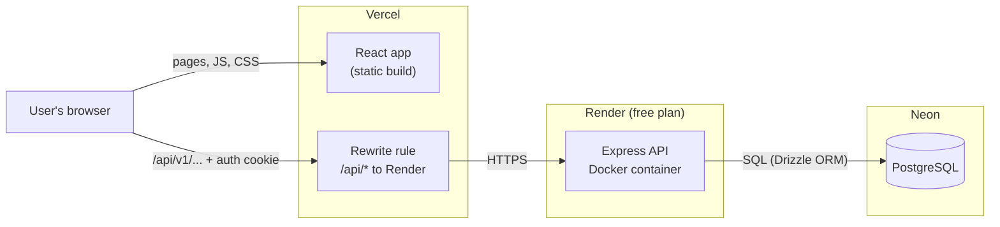
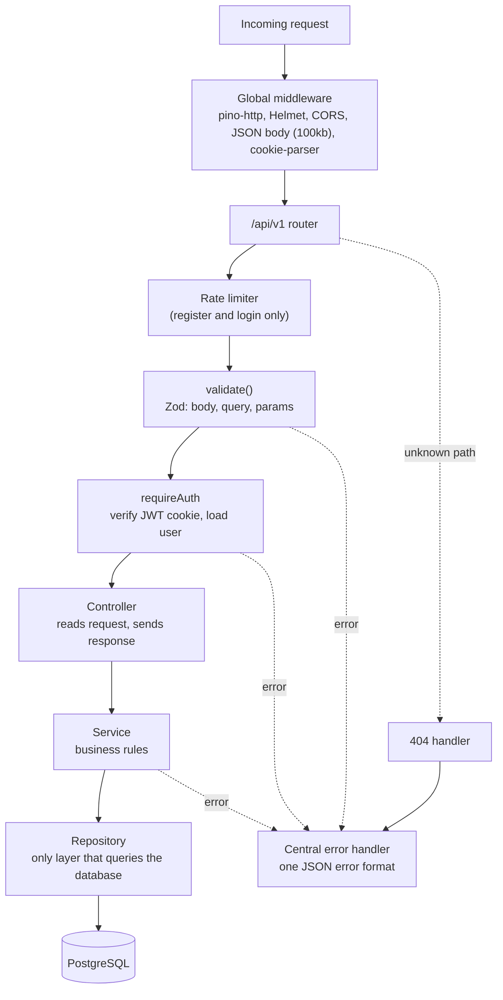

# Sweety

**A blood glucose tracker for diabetes patients.** Record up to four readings a day, one per meal slot, and review daily, month-to-date and monthly reports.


## Live demo

**App:** https://sweetyy-anwesha2002.vercel.app

| Part                  | Hosted on | Address                                |
| --------------------- | --------- | -------------------------------------- |
| Frontend (React)      | Vercel    | https://sweetyy-anwesha2002.vercel.app |
| Backend (Express API) | Render    | https://sweety-8dhg.onrender.com       |
| Database (PostgreSQL) | Neon      | (private)                              |

> [!IMPORTANT]
> **The first request after a period of inactivity can take about 30 seconds.**
> The backend runs on Render's free plan, which shuts the server down when it has been idle for a while. The next request (usually logging in or registering) waits while the server starts up again. After that, the app responds normally.

## Contents

- [Screenshots](#screenshots)
- [Features](#features)
- [Architecture](#architecture)
- [Tech stack](#tech-stack)
- [Folder structure](#folder-structure)
- [Getting started](#getting-started)
- [API endpoints](#api-endpoints)
- [Assumptions & decisions](#assumptions--decisions)
- [Future scope](#future-scope)

## Screenshots

<table>
  <tr>
    <td></td>
    <td></td>
  </tr>
  <tr>
    <td></td>
    <td></td>
  </tr>
  <tr>
    <td></td>
    <td></td>
  </tr>
  <tr>
    <td></td>
    <td></td>
  </tr>
</table>

<details>
<summary><b>Full Reports page</b> (long screenshot)</summary>


</details>

## Features

### Required

| Feature                 | What it does                                                                                                                                                                                                                        |
| ----------------------- | ----------------------------------------------------------------------------------------------------------------------------------------------------------------------------------------------------------------------------------- |
| **Sign up and log in**  | Register (which also logs you in), login, logout, current user. Passwords are hashed with bcrypt. A JWT is kept in an HttpOnly cookie. Register and login are rate-limited.                                                        |
| **Readings**            | Create, list, get, update and delete. Each user only ever sees their own readings.                                                                                                                                                  |
| **Validation rules**    | Value required and a whole number from 40 to 600, one reading per slot per day, at most 4 per day, no future dates. Each rule returns the exact error message from the brief, and the UI shows it.                                 |
| **Reports**             | Daily (with each reading and its slot), month-to-date and previous month. Each shows highest, lowest, average (1 decimal) and count, with a friendly empty state.                                                                  |
| **Dashboard**           | This month's summary plus today's four slots, with an add/edit reading dialog.                                                                                                                                                      |
| **Backend foundation**  | Central error handler with one response format, Zod validation middleware, environment validation at startup, Pino logging with redaction, Helmet, CORS, health check, graceful shutdown.                                         |
| **Database**            | PostgreSQL via Drizzle ORM: `users`, `glucose_readings`, a `reading_slot` enum, a unique constraint for one reading per slot per day, and `CHECK (value BETWEEN 40 AND 600)`. All declared in code and applied through migrations. |
| **Tests**               | Backend (Vitest + Supertest): auth, readings, reports, date helpers. Frontend (Vitest + React Testing Library): login, reading form, dashboard, reports page, date and form utilities.                                              |

### Bonus tasks

| Bonus task                                   | Status | Notes                                                                                                         |
| -------------------------------------------- | :----: | ------------------------------------------------------------------------------------------------------------- |
| Pagination on `GET /readings`                |   ✅   | `page` and `pageSize` query parameters; My Readings page has filters and pagination                           |
| Line chart of readings                       |   ✅   | Glucose trend chart on the Reports page (a day, a month, or any range up to a year). Hand-written SVG, no chart library |
| Docker                                       |   ✅   | `docker-compose.yml` for the dev database; `docker-compose.prod.yml` and a `Dockerfile` for deployment        |
| Frontend tests with React Testing Library    |   ✅   | Reading form and other components                                                                             |
| Redis caching of reports                     |   ❌   | See [Future scope](#future-scope)                                                                             |
| BullMQ background job                        |   ❌   | Not implemented                                                                                               |
| Doctor role                                  |   ❌   | See [Future scope](#future-scope)                                                                             |

Also not implemented: CSV export, refresh tokens, password reset.

## Architecture

### Deployment



The browser only ever talks to the Vercel domain. Vercel forwards every `/api/*` request to Render (see [`client/vercel.json`](client/vercel.json)), so the frontend and API share one origin. That keeps the `SameSite=Lax` auth cookie working without CORS or CSRF tokens.

### Request flow inside the API



Each feature (`auth`, `users`, `readings`, `reports`, `health`) is a module with its own routes, controller, service and repository. More detail, including the authentication flow, date convention and error format: [docs/architecture.md](docs/architecture.md).

## Tech stack

| Area    | Technology                                                                                                                                                           |
| ------- | -------------------------------------------------------------------------------------------------------------------------------------------------------------------- |
| Client  | React 19, TypeScript, Vite, Tailwind CSS 4, React Router 8, Axios, React Hook Form, Zod 4, Lucide React                                                              |
| Server  | Node.js, Express 5, TypeScript (ESM, `tsx` for dev, `tsc` for builds), Drizzle ORM + `pg`, bcrypt, jsonwebtoken, Zod 4, Helmet, cors, cookie-parser, express-rate-limit, Pino + pino-http |
| Database| PostgreSQL (Neon in production, Docker locally)                                                                                                                      |
| Tests   | Vitest, Supertest (server); Vitest, jsdom, React Testing Library (client)                                                                                            |
| Tooling | ESLint (flat config), Prettier, concurrently                                                                                                                         |
| Hosting | Vercel (frontend), Render (API)                                                                                                                                      |

Pinned on purpose: **TypeScript 6.0.x** (`typescript-eslint` does not support 7 yet), **drizzle-orm 0.45.4** and **drizzle-kit 0.31.11** (Drizzle is still 0.x, so its versions are pinned exactly).

## Folder structure

```
sweety/
├── client/                 React app (components, pages, services, hooks, context, schemas, routes...)
│   └── vercel.json         Vercel config: /api rewrite to Render + SPA fallback
├── server/
│   ├── drizzle/            generated SQL migrations (0000_init.sql ...)
│   ├── src/                config, db (schema, seed), modules (auth, users, readings, reports, health), middleware, utils, constants
│   └── tests/
├── docs/                   architecture.md, api.md, deployment.md, HANDOVER.md
├── docker/                 init script that creates the two development databases
├── docker-compose.yml      development database (PostgreSQL)
├── docker-compose.prod.yml production stack for your own server: web (nginx) + API + PostgreSQL
├── Dockerfile              one-container image used by Render
├── render.yaml             Render Blueprint (free web service)
└── package.json            workspaces + root scripts
```

## Getting started

### Prerequisites

- **Node.js 22 LTS**, version `22.22.0` or newer (React Router 8 needs it). `nvm use` reads `.nvmrc`.
- **PostgreSQL 14+**: Docker (recommended), a local install, or a hosted database such as Neon or Supabase.

### 1. Install dependencies

```bash
npm install
```

### 2. Create the env files

```bash
cp server/.env.example server/.env
cp server/.env.test.example server/.env.test
```

Set a real `JWT_SECRET` (32+ characters) in `server/.env`. Generate one with:

```bash
node -e "console.log(require('crypto').randomBytes(48).toString('hex'))"
```

> [!CAUTION]
> Never commit `server/.env` or `server/.env.test`. Both are gitignored.

### 3. Start PostgreSQL

- **Docker (recommended):** `docker compose up -d` starts Postgres on host port **5434** (5433 is often taken by other projects) and creates the `sweety` and `sweety_test` databases. The example env files already use these URLs.
- **Local or hosted Postgres (for example Neon):** use two separate databases, one for development and one for tests, and put their connection strings in `server/.env` and `server/.env.test`. Never put real URLs in the `*.example` files. Add `?sslmode=require` if your provider asks for SSL.

> [!WARNING]
> The tests **truncate every table**, so never point `server/.env.test` at the development database. The test setup refuses to run unless the test database's name ends in `_test`, or it is on a different server than the development database (for example a separate Neon branch).

### 4. Apply migrations and seed a demo user

```bash
npm run db:migrate
npm run db:seed     # optional
```

The demo user is `demo@example.com` / `demo-password-123` (no readings). It is for local development only; the seed refuses to run when `NODE_ENV=production`.

### 5. Run, test, build

```bash
npm run dev         # server (http://localhost:4000) and client (http://localhost:5173) together
npm run test        # server tests, then client tests
npm run build       # builds server (dist/) and client (client/dist/)
npm run lint
npm run typecheck
npm run db:studio   # Drizzle Studio (browse the database)
```

Open http://localhost:5173. In development the Vite dev server proxies `/api` to the Express server, so the browser only ever talks to one origin. Server tests apply the migrations to the test database before the run and truncate the tables before each test.

To deploy your own copy (Render, or your own server with Docker), see [docs/deployment.md](docs/deployment.md).

## API endpoints

| Method | Path                            | Auth                 | Purpose                                           |
| ------ | ------------------------------- | -------------------- | ------------------------------------------------- |
| GET    | `/api/v1/health`                | public               | Status and database check                         |
| POST   | `/api/v1/auth/register`         | public, rate-limited | Create an account and log in                      |
| POST   | `/api/v1/auth/login`            | public, rate-limited | Log in                                            |
| POST   | `/api/v1/auth/logout`           | public               | Clear the cookie                                  |
| GET    | `/api/v1/auth/me`               | required             | Current user                                      |
| POST   | `/api/v1/readings`              | required             | Add a reading                                     |
| GET    | `/api/v1/readings`              | required             | List readings (`from`, `to`, `page`, `pageSize`)  |
| GET    | `/api/v1/readings/:id`          | required             | Get one reading                                   |
| PUT    | `/api/v1/readings/:id`          | required             | Update a reading (partial)                        |
| DELETE | `/api/v1/readings/:id`          | required             | Delete a reading                                  |
| GET    | `/api/v1/reports/daily`         | required             | Summary and readings for `date`                   |
| GET    | `/api/v1/reports/month-to-date` | required             | 1st of the month up to `date`                     |
| GET    | `/api/v1/reports/monthly`       | required             | The whole month before `date`'s month             |
| GET    | `/api/v1/reports/trend`         | required             | Daily averages from `from` to `to` (max 366 days) |

Request and response examples for every endpoint: [docs/api.md](docs/api.md).

## Assumptions & decisions

- **Auto-login after registration.** `POST /auth/register` creates the user, sets the auth cookie and returns the user, so people do not have to log in right after signing up.
- **Token lifetime.** There are no refresh tokens, so tokens last `1d` (`JWT_EXPIRES_IN`) and the cookie `maxAge` matches. Token code is isolated in `server/src/modules/auth/auth.token.ts` so refresh tokens can be added later.
- **Order of the reading rules.** When creating a reading the server checks, in this order: validation, future date, the 4-per-day limit, then the duplicate slot. The limit must come before the duplicate check: a 5th reading on a day is always also a duplicate slot (there are only 4), so otherwise "You can add only 4 readings per day." could never appear. The database unique index is the final safety net for concurrent requests.
- **Dates and time zone.** The API only sends and receives dates as `YYYY-MM-DD` strings, and the database `date` columns use string mode too, so there is no time-zone conversion anywhere. Date arithmetic in `server/src/utils/date.ts` goes through a UTC `Date`. For the "no future dates" rule, the client sends its local date and the server allows dates up to **today (UTC) plus one day**, which tolerates every time zone. The client builds dates from local date parts (`client/src/utils/date.ts`), never from `toISOString()`. Details: [docs/architecture.md](docs/architecture.md#date-convention).
- **CSRF / SameSite.** No CSRF token library. In development the Vite proxy makes everything same-origin; in production the Vercel rewrite does the same. With `SameSite=Lax`, JSON-only endpoints and strict CORS (`CLIENT_URL` only) this is sufficient. Hosting the API on a separate, cross-site domain would need `SameSite=None; Secure` **plus** CSRF tokens.
- **CHECK constraint.** `value BETWEEN 40 AND 600` is declared in `server/src/db/schema.ts` with Drizzle's `check()`, built from `GLUCOSE_MIN` / `GLUCOSE_MAX`, and `npm run db:generate` puts it into the generated migration SQL. No SQL is edited by hand.
- **Reports and dates.** Report endpoints accept any valid date (a future date gives an empty report); the UI limits the picker to today. The dashboard reuses the report endpoints (today's daily report for the slot cards, month-to-date for the stat cards).
- **Rate limiting** applies to register and login only (10 requests per 15 minutes per IP) and is off when `NODE_ENV=test`. `TRUST_PROXY` must be set behind a reverse proxy so client IPs and secure cookies work.
- **bcrypt vs bcryptjs.** The native `bcrypt` package installed fine, so it is used. `bcryptjs` is only a fallback if native installation fails on a machine.
- **Client/server schema duplication.** The client and server each own a copy of the Zod auth rules (and slot labels) so the apps stay independent; comments mark the pairs that must stay in sync.

## Future scope

- Redis caching of report results, cleared when a reading changes
- Doctor role with a dashboard for assigned patients
- Password reset by email for users who forget their password
- Refresh tokens, so sessions can last longer without long-lived access tokens
